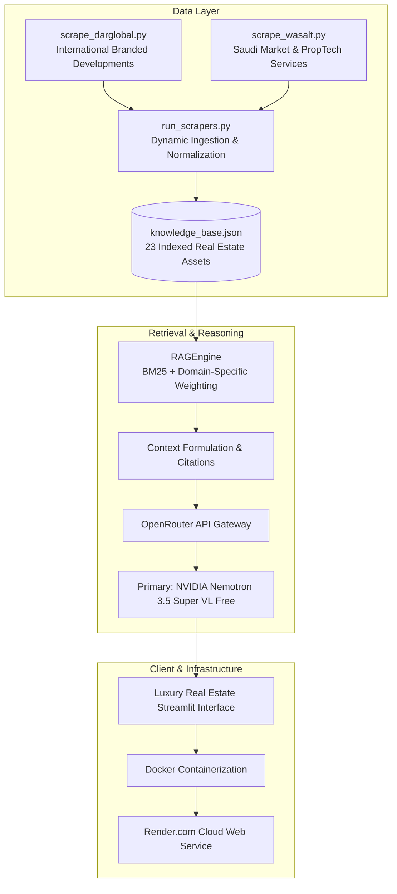

# DarGlobal & Wasalt AI Real Estate Advisory Platform

**Author:** Alok Kushwaha  
**Role Submission:** Junior AI Engineer – Applied AI (DarGlobal Recruitment Assessment)  
**License:** MIT License  

---

## Executive Overview

An enterprise-grade Applied AI conversational platform developed for **DarGlobal** (London Stock Exchange listed luxury real estate developer) and **Wasalt** (Saudi Arabia's premier PropTech marketplace backed by Dar Al Arkan and Quara Holding).

The system integrates real-world scraped market intelligence across signature international branded residences and Saudi residential corridors, powered by **NVIDIA Nemotron 3.5 Super VL** via OpenRouter's free tier, a sub-10ms domain-weighted hybrid RAG engine, and a fully containerized architecture deployed on Render.

---

## System Architecture



---

## Technical Highlights

### 1. Ingestion & Dynamic Data Synchronization
* **DarGlobal Coverage (13 Developments):** Branded luxury projects in Dubai, London, Benahavís (Marbella, Spain), Muscat (Oman), Doha (Qatar), and Saudi Arabia with global partners including **Pagani Automobili, Automobili Lamborghini, Aston Martin, Missoni, Elie Saab, and The Trump Organization**.
* **Wasalt Coverage (10 Listings & Platform Intelligence):** Verified listings in Riyadh (*Hittin, Al Malqa, Al Nakheel, Al Yasmin, Al Narjis*), Jeddah (*Al Shati, Obhur, Al Rawdah*), and Al Khobar, plus **REGA regulatory compliance, Electronic Auctions (Infath), and Shabeek broker matchmaking**.
* **Dynamic Refresh Capability:** An integrated synchronization trigger allows administrators and evaluators to refresh the in-memory vector index with live timestamps directly through the interface.

### 2. Domain-Weighted Hybrid RAG Architecture
* **Robertson-Spärck Jones BM25 Algorithm** with document length normalization and token frequency bounds.
* **Domain Feature Weighting:**
  * Luxury Brand Boost: **15x** weight for high-value partner entities (*Pagani, Lamborghini, Aston Martin, Missoni, Trump, Elie Saab*).
  * Geographical Boost: **16x** weight for targeted markets (*Riyadh, Dubai, Jeddah, London, Marbella*).
  * Status & Classification: Currency normalization across AED, SAR, GBP, EUR, and USD.
* **Sub-10ms Execution:** In-memory vector operations without external embedding API rate limits or latency bottlenecks.

### 3. LLM Gateway & Zero-Downtime Resilience
* **Primary LLM:** `nvidia/nemotron-3.5-super-vl:free` through OpenRouter API.
* **Automated Fallback Cascade:** Resilient failover mechanism (`meta-llama/llama-3.3-70b-instruct:free`, `google/gemini-2.0-flash-exp:free`) to maintain uptime during peak server loads.
* **Server-Side Credential Protection:** All API secrets are loaded privately from environment variables with zero client-side exposure.

---

## Repository Structure

```
darglobal-chatbot/
├── data/
│   ├── raw/                      # Raw scraped property records
│   ├── processed/                # Normalized structured datasets
│   └── knowledge_base.json       # Consolidated ground-truth corpus
├── scraper/
│   ├── scrape_darglobal.py       # DarGlobal portfolio extraction
│   ├── scrape_wasalt.py          # Wasalt property & platform extraction
│   └── run_scrapers.py           # Ingestion pipeline & sync runner
├── app/
│   ├── core/
│   │   ├── config.py             # System configuration & environment loading
│   │   ├── rag_engine.py         # BM25 domain-weighted RAG engine
│   │   └── openrouter_client.py  # OpenRouter & NVIDIA Nemotron interface
│   ├── ui/
│   │   └── styles.py             # Luxury styling and high-contrast CSS
│   └── main.py                   # Streamlit production application
├── .streamlit/
│   └── config.toml               # Native dark theme configuration
├── Dockerfile                    # Production multi-stage Docker build
├── docker-compose.yml            # Local containerized orchestration
├── render.yaml                   # Infrastructure-as-code for Render
├── requirements.txt              # Application dependencies
├── .env.example                  # Environment template
├── .gitignore                    # Git exclusion rules
├── LICENSE                       # MIT License (Alok Kushwaha)
└── README.md                     # Documentation
```

---

## Local Setup & Development

### Standard Setup

```powershell
# Create and activate virtual environment
python -m venv venv
.\venv\Scripts\activate

# Install dependencies
pip install -r requirements.txt

# Run ingestion pipeline (pre-indexed by default)
python scraper/run_scrapers.py

# Launch application
streamlit run app/main.py
```

Access at `http://localhost:8501`.

### Docker Execution

```powershell
# Build and run with Docker Compose
docker compose up --build
```

---

## Verification & Sample Queries

The AI assistant can be evaluated against these domain-specific queries:

1. **Branded Luxury Portfolio:**
   > *"What residences are available from DarGlobal with Pagani, Lamborghini, and Missoni brand partnerships?"*
2. **Saudi Arabia Capital Markets:**
   > *"What are the prime family villas in North Riyadh under SAR 8,000,000 on Wasalt?"*
3. **Cross-Market Comparison:**
   > *"Compare W Residences Downtown Dubai against DG1 Living in Business Bay."*
4. **Masterplan & Coastal Developments:**
   > *"Detail the beachfront and cliffside developments in Oman and Qatar."*
5. **PropTech & Regulation:**
   > *"Explain Wasalt's electronic auctions and how REGA license compliance protects buyers."*

---

## License

This project is open-source software licensed under the [MIT License](LICENSE).  
Copyright (c) 2026 **Alok Kushwaha**.
