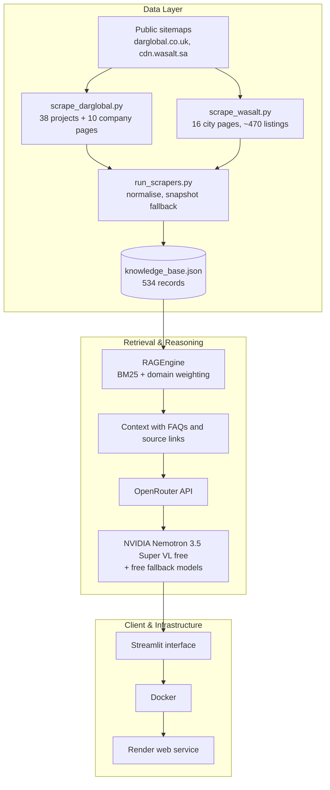
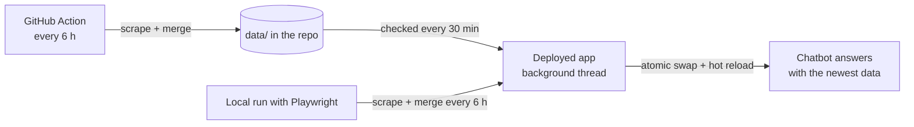

# DarGlobal & Wasalt AI Real Estate Advisory Platform

**Author:** Alok Kushwaha  
**Role Submission:** Junior AI Engineer – Applied AI (DarGlobal Recruitment Assessment)  
**License:** MIT License  

**Live demo:** _add your Render URL here_  
**Data:** 534 records scraped from darglobal.co.uk and wasalt.sa on 20 Nov 2026 (see `data/scrape_meta.json`)

---

## Executive Overview

A conversational assistant for **DarGlobal** (London Stock Exchange listed luxury real estate developer) and **Wasalt** (Saudi property marketplace). It answers questions about DarGlobal's projects and company, and about Wasalt listings and city markets, using only data scraped from the two public websites.

Stack: Python scrapers (Playwright + sitemaps) → normalised knowledge base → BM25 retrieval with domain weighting → **NVIDIA Nemotron 3.5 Super VL** (free) through OpenRouter → Streamlit UI, packaged with Docker and deployed on Render.

---

## System Architecture



---

## Data: what is scraped and how

Both sites are Next.js apps protected by bot checks (Imperva on darglobal.co.uk, Cloudflare on wasalt.sa). A plain `requests.get` receives a challenge page, so pages are loaded in a real Chromium browser through Playwright, and the scraper reads the structured page data (`__NEXT_DATA__`) that each page is rendered from. No fingerprint spoofing or CAPTCHA solving is used: if a site shows an interactive check, the scraper stops and keeps the last good snapshot.

**DarGlobal (`scraper/scrape_darglobal.py`)**
1. Reads the full project catalogue from https://darglobal.co.uk/projects (title, location, country, type, completion date, link).
2. Opens every project page and extracts key facts (property type, status, unit types, area), description, amenities, "why invest" notes and the project's own FAQ.
3. Scrapes 10 company pages: about, investor relations, why invest (visa/tax by country), FAQ, hospitality, commercial, partners, golf communities, development management, tokenization.

**Wasalt (`scraper/scrape_wasalt.py`)**
1. Finds city pages in Wasalt's public category sitemap (`cdn.wasalt.sa`).
2. For 8 cities (Riyadh, Jeddah, Al Khobar, Dammam, Makkah, Madinah, Taif, Abha), sale and rent: the newest ~30 listings per page (type, district, price, bedrooms, bathrooms, area, link), the city guide text, its FAQ and the total live listing count.
3. Builds a market-guide record per page with a median-price snapshot by property type from that sample.
4. Agent names and phone numbers are not stored. `robots.txt` disallows `/search`, so only city pages are used.

**Pipeline (`scraper/run_scrapers.py`)** scrapes both sites, normalises them into one schema and writes `data/knowledge_base.json` plus `data/scrape_meta.json` (when each site was scraped, and whether the data is live or a snapshot). If one site fails, its last good snapshot in `data/raw/` is kept, so the chatbot never loses data.

### Live data: refreshed in the background while the bot keeps answering



* **Incremental merge, not overwrite** (`merge_records` in `run_scrapers.py`): new listings are added, re-seen ones are updated and keep their `first_seen` date, Wasalt listings that drop off the newest-30 page stay searchable for 30 days after they were last seen (`LISTING_RETENTION_DAYS`), capped at 5,000. DarGlobal's project catalogue is authoritative, so a project removed from the site is removed here.
* **Background refresher** (`app/core/live_data.py`): a daemon thread inside the app refreshes on a schedule. With Playwright installed it scrapes the sites itself (`REFRESH_MODE=live`, every 6 h). In the deployed container it pulls the data the GitHub Action published (`REFRESH_MODE=remote`, every 30 min) when that data is newer.
* **No downtime:** files are written to a temp file and renamed, so a question never reads half-written data. Every question asks for the current index, which reloads only when the file changed (about 50 ms for 534 records), so new data is used from the next question on, with no restart. Tested: 22 questions answered (about 5 ms retrieval each) during a 65-second live DarGlobal scrape, then the new data was picked up automatically.
* **Scheduled scrape:** `.github/workflows/refresh-data.yml` runs every 6 hours (or on demand from the Actions tab), scrapes in a real Chromium under a virtual display, and commits `data/` only if something changed. `render.yaml` ignores `data/**` for builds, so these commits don't redeploy the service; the running app pulls them itself.
* The sidebar shows when each site was scraped, the record count, the refresh mode and the next run, and updates itself every 30 s. **Sync Latest Market Data** starts a refresh in the background without blocking the chat.

Settings (environment variables): `REFRESH_MODE` (auto / live / remote / off), `REFRESH_INTERVAL_MINUTES`, `REFRESH_SOURCES` (all / darglobal / wasalt), `DATA_SYNC_BASE_URL`, `LISTING_RETENTION_DAYS`, `MAX_WASALT_LISTINGS`.

### Running the scraper by hand

```powershell
pip install -r requirements.txt -r requirements-scraper.txt
python -m playwright install chromium

python -m scraper.run_scrapers                 # live scrape of both sites (~2 min)
python -m scraper.run_scrapers --only wasalt   # one site
python -m scraper.run_scrapers --cached        # rebuild from data/raw/ without scraping
```

Every run merges into the existing data and reports how many records were added, updated and kept in `data/scrape_meta.json`.

### When Wasalt shows a bot check

Cloudflare sometimes shows an interactive check to an automated browser after several runs from the same machine. The scraper stops early instead of retrying. For the 20 Nov 2026 snapshot this happened after the first city page, so the 16 Wasalt city pages were collected in an ordinary browser session with the same field extraction, saved as `data/raw/wasalt_browser_export.json`, and converted with `records_from_browser_export()` in `scrape_wasalt.py`, so the records are identical in format to a scraper run.

---

## Retrieval & answer quality

* **BM25** (Robertson–Spärck Jones IDF, length normalisation) over title, brand partner, location, type, description, amenities, investment notes, FAQs and page text.
* **Domain boosts** for brand partners (Pagani, Lamborghini, Aston Martin, Missoni, Trump, Elie Saab, Fendi Casa, Mouawad), cities, districts and the source the user names.
* **Grounded prompt:** the model may only use facts from the retrieved context, must not add prices, taxes, visa rules or dates from general knowledge, presents Wasalt prices as a sample, and ends with the official links.
* **Known limitation:** with several countries in one retrieved page (e.g. "why invest"), the model can occasionally attach a fact to the wrong country. Answers always cite the source page so it can be checked.

### LLM gateway
* **Primary:** `nvidia/nemotron-3.5-super-vl:free` via OpenRouter.
* **Fallbacks on rate limit or error** (checked against OpenRouter's model list on 20 Nov 2026): `nvidia/nemotron-3-ultra-550b-a55b:free`, `google/gemma-4-31b-it:free`, `google/gemma-4-26b-a4b-it:free`, `nvidia/nemotron-3.5-lightning:free`.
* The API key is read from the `OPENROUTER_API_KEY` environment variable and never sent to the browser.

---

## Repository Structure

```
darglobal-chatbot/
├── data/
│   ├── raw/                          # Scraped records per site (+ Wasalt browser export)
│   ├── processed/                    # Normalised records per site
│   ├── knowledge_base.json           # What the chatbot searches
│   └── scrape_meta.json              # When each site was scraped, live or snapshot
├── scraper/
│   ├── browser.py                    # Playwright session, sitemap + page helpers
│   ├── scrape_darglobal.py           # DarGlobal projects + company pages
│   ├── scrape_wasalt.py              # Wasalt city pages, listings, market guides
│   └── run_scrapers.py               # Pipeline with snapshot fallback
├── app/
│   ├── core/
│   │   ├── live_data.py              # Background refresher + hot reload
│   │   ├── config.py                 # Settings and model list
│   │   ├── rag_engine.py             # BM25 + domain weighting
│   │   ├── openrouter_client.py      # OpenRouter client with fallbacks
│   │   └── pdf_exporter.py           # Chat export to PDF
│   ├── ui/styles.py                  # Styling
│   └── main.py                       # Streamlit app
├── .github/workflows/refresh-data.yml  # Scheduled scrape every 6 h
├── Dockerfile / docker-compose.yml / render.yaml
├── requirements.txt                  # App dependencies
├── requirements-scraper.txt          # + Playwright for live scraping
└── .env.example
```

---

## Local Setup

```powershell
python -m venv venv
.\venv\Scripts\activate
pip install -r requirements.txt
copy .env.example .env               # then add your OPENROUTER_API_KEY
streamlit run app/main.py            # http://localhost:8501
```

### Docker

```powershell
docker compose up --build            # http://localhost:8501
```

### Deploy on Render

New → Blueprint → select this repository (uses `render.yaml`) → set `OPENROUTER_API_KEY` → Apply. The free plan sleeps after 15 minutes idle; the first request after that takes about a minute.

---

## Sample Questions

1. *"Is W Residences Dubai still available, and how many bedrooms do the units have?"*
2. *"What are the unit types and sizes at The Astera by Aston Martin?"*
3. *"Which DarGlobal projects are in Saudi Arabia, and when do they complete?"*
4. *"What does Wasalt show for apartments for rent in Jeddah, and at what prices?"*
5. *"How many properties are listed for sale in Riyadh on Wasalt, and what do villas cost there?"*
6. *"How can an investor get residency in Oman through DarGlobal?"*

---

## License

This project is open-source software licensed under the [MIT License](LICENSE).  
Copyright (c) 2026 **Alok Kushwaha**.
