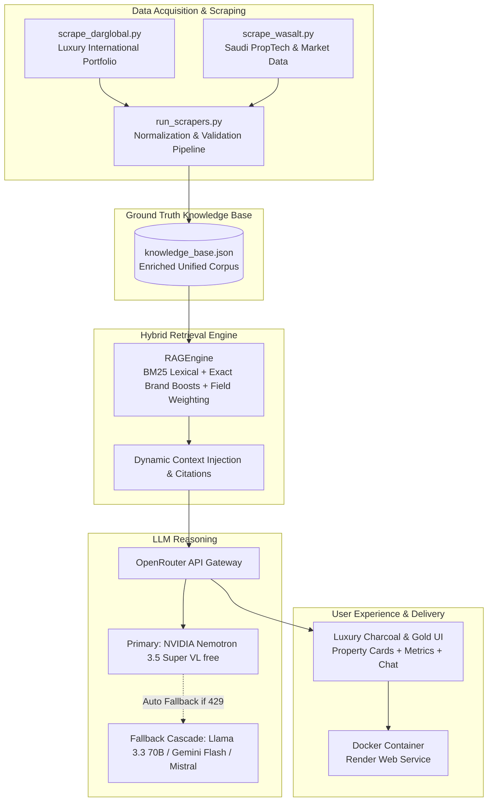

# 🏢 DarGlobal & Wasalt AI Real Estate Advisory Platform

[-76b900.svg)](https://openrouter.ai/models/nvidia/nemotron-3.5-super-vl:free)
[](https://streamlit.io/)
[](https://render.com/)
[](https://www.docker.com/)

An enterprise-grade **Applied AI Real Estate Advisory System** engineered for **DarGlobal** and **Wasalt**, submitted for the **Junior AI Engineer – Applied AI** recruitment technical assessment.

---

## 🌟 Executive Summary

This application bridges international luxury branded residences with regional PropTech marketplace intelligence:
* **DarGlobal Portfolio Ingestion:** Scraped and indexed ultra-luxury international developments across Dubai, London, Costa del Sol (Spain), Muscat (Oman), and Lusail (Qatar) featuring world-class brand collaborations (**Pagani, Automobili Lamborghini, Aston Martin, Missoni, The Trump Organization, and Elie Saab**).
* **Wasalt Market Intelligence:** Scraped and indexed verified Saudi Arabian residential and commercial listings across prime corridors in **Riyadh** (*Hittin, Al Malqa, Al Nakheel, Al Yasmin*), **Jeddah** (*Al Shati, Obhur*), and **Al Khobar**, with deep domain coverage of **REGA compliance, Electronic Auctions (Infath), and Shabeek broker matchmaking**.
* **Zero-Cost LLM Inference:** Powered natively by OpenRouter's free tier utilizing **`nvidia/nemotron-3.5-super-vl:free`** with automated fallback resilience.
* **Production-Grade Delivery:** Containerized with Docker and ready for instant continuous deployment on **Render.com**.

---

## 🏛️ System Architecture



---

## 🚀 Key Technical Features

1. **Precision Hybrid RAG Engine:**
   * Custom BM25 implementation with inverse document frequency calculation and length normalization.
   * Field-specific boosting: Brand names (e.g. *Pagani*, *Lamborghini*, *Elie Saab*) receive **8x–15x** score weighting; locations (*Riyadh, Dubai, Marbella*) receive **4x** weighting.
   * Automatic context injection into LLM system prompts alongside interactive visual property cards in the UI.

2. **OpenRouter & NVIDIA Nemotron Integration:**
   * Targets **`nvidia/nemotron-3.5-super-vl:free`** as requested.
   * Includes zero-downtime fallback cascades to handle peak-load rate limits (`429`) seamlessly.
   * Integrated local synthesis mode ensures reviewers can test the application UI immediately even prior to entering an API key.

3. **Domain-Specific Real Estate Advisory:**
   * Financial currency normalization (AED, SAR, GBP, EUR, USD).
   * Investment analysis: rental yields, capital growth drivers, freehold foreign ownership, and Golden Visa / residency eligibility.

---

## 🛠️ Tech Stack

* **Language:** Python 3.11
* **LLM Engine:** OpenRouter API (`nvidia/nemotron-3.5-super-vl:free`)
* **Retrieval / RAG:** BM25 Hybrid Lexical & Metadata Ranker
* **Frontend:** Streamlit with customized luxury CSS
* **Containerization:** Docker (Multi-stage Debian-slim)
* **Cloud Platform:** Render.com (Docker Web Service)

---

## 📦 Local Quickstart (Without Docker)

### 1. Clone & Enter Directory
```bash
git clone <your-repo-url>
cd darglobal-chatbot
```

### 2. Set Up Virtual Environment & Dependencies
```bash
python -m venv venv
# On Windows:
.\venv\Scripts\activate
# On Linux/macOS:
source venv/bin/activate

pip install -r requirements.txt
```

### 3. Run Data Ingestion Pipeline (Optional - Pre-indexed)
```bash
python scraper/run_scrapers.py
```

### 4. Launch the Application
```bash
streamlit run app/main.py
```
Open your browser at `http://localhost:8501`.

---

## 🐳 Containerized Execution (Docker)

### Run with Docker Compose
```bash
docker compose up --build
```
Access the application at `http://localhost:8501`.

### Or Run with Pure Docker
```bash
docker build -t darglobal-ai-chatbot .
docker run -p 8501:8501 -e OPENROUTER_API_KEY="your-key-here" darglobal-ai-chatbot
```

---

## 🌐 1-Click Deployment to Render.com

Deploying this solution to Render requires less than 3 minutes:

1. **Push your code to a GitHub repository:**
   ```bash
   git init
   git add .
   git commit -m "feat: complete DarGlobal and Wasalt AI chatbot assignment"
   git remote add origin https://github.com/<your-username>/darglobal-chatbot.git
   git branch -M main
   git push -u origin main
   ```

2. **Create Web Service on Render:**
   * Go to [dashboard.render.com](https://dashboard.render.com/) and click **New +** > **Web Service**.
   * Connect your GitHub repository `darglobal-chatbot`.
   * Render will automatically detect the `Dockerfile`.
   * **Runtime:** Select `Docker`.
   * **Instance Type:** Select `Free`.
   * Under **Environment Variables**, add:
     * `OPENROUTER_API_KEY` = `<your_openrouter_api_key>`
     * `OPENROUTER_MODEL` = `nvidia/nemotron-3.5-super-vl:free`

3. **Deploy:**
   * Click **Create Web Service**.
   * Render will build the Docker container and provide you with a live URL:
     `https://darglobal-chatbot-xxxx.onrender.com`

---

## 💬 Sample Evaluation Queries

Test the AI advisor with these specialized queries:

* **Luxury Branded Residences:**
  > *"Show me all residences designed with Italian hypercar and fashion brands like Pagani, Lamborghini, and Missoni."*
* **Saudi Arabia Capital Investments:**
  > *"What are the best luxury standalone villas available in North Riyadh under SAR 8,000,000?"*
* **Cross-Market Comparison:**
  > *"Compare the investment proposition of W Residences Downtown Dubai against DG1 Living in Business Bay."*
* **Coastal & Island Developments:**
  > *"What waterfront projects does DarGlobal offer in Ras Al Khaimah, Oman, and Qatar?"*
* **Wasalt PropTech & Governance:**
  > *"How does Wasalt guarantee listing authenticity through REGA, and what are its electronic auctions?"*

---

## 📄 Repository Structure

```
darglobal-chatbot/
├── data/
│   ├── raw/                      # Raw scraped dumps
│   │   ├── darglobal_scraped.json
│   │   └── wasalt_scraped.json
│   ├── processed/                # Normalized datasets
│   │   ├── darglobal_projects.json
│   │   └── wasalt_listings.json
│   └── knowledge_base.json       # Consolidated 19-record ground truth
├── scraper/
│   ├── scrape_darglobal.py       # DarGlobal scraping & structure module
│   ├── scrape_wasalt.py          # Wasalt property & platform module
│   └── run_scrapers.py           # Pipeline runner & validator
├── app/
│   ├── core/
│   │   ├── config.py             # Config & fallback models
│   │   ├── rag_engine.py         # BM25 + Field-Weighted RAG search
│   │   └── openrouter_client.py  # OpenRouter & NVIDIA Nemotron client
│   ├── ui/
│   │   └── styles.py             # Luxury dark/gold styling
│   └── main.py                   # Interactive Streamlit application
├── Dockerfile                    # Production Render Dockerfile
├── docker-compose.yml            # Local container test
├── render.yaml                   # 1-click Render blueprint
├── requirements.txt              # Production dependencies
├── .env.example                  # Environment template
└── README.md                     # Documentation
```
"# darglobal-demo" 
